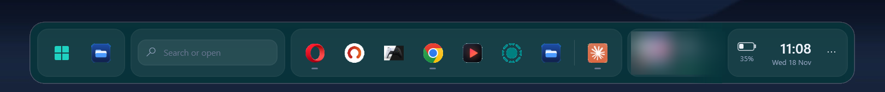
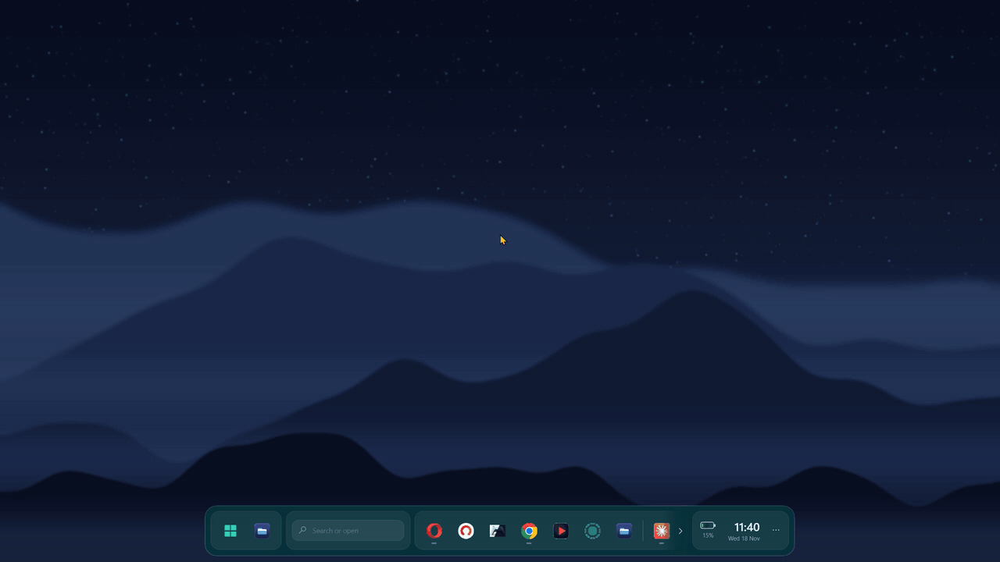

# GlassBar

A free alternative to Lumabar: a dark, glassy taskbar replacement for Windows 10, built with WPF (.NET 8).
It sits on any screen edge, hides until you need it and puts your
everyday tools on scrollable glass cards: open windows, chats, mail, music, files,
system stats, screen recording, a terminal, phone transfers and a glass Start menu.

Part of the **ModernGlass** set, together with [GlassExplorer](https://github.com/carrotunderscore/GlassExplorer)
and the ModernGlass Windows theme.





## Install

**Quickest:** download `GlassBar.exe` from [Releases](https://github.com/carrotunderscore/GlassBar/releases/latest) and run it.
It's a single self-contained file, so nothing else needs to be installed (WebView2 ships with Windows 10/11).
It doesn't add a Start menu shortcut or start with Windows; use the installer below for that.

**Installer:**

1. Download `GlassBar-v1.3.0-win-x64.zip` from [Releases](https://github.com/carrotunderscore/GlassBar/releases/latest) and unzip it.
2. Right-click **`Install.ps1`** and choose **Run with PowerShell**.
   - Copies the app to `%LOCALAPPDATA%\Programs\GlassBar` (no admin needed)
   - Installs what's missing with `winget`: .NET 8 Desktop Runtime, ASP.NET Core Runtime 8, WebView2
   - Adds a Start menu shortcut and starts GlassBar with Windows
   - Offers to install `ffmpeg` (only needed for the screen recorder)
3. When Windows Firewall asks about network access, click **Allow**. This is needed for LocalSend.
   If your Wi-Fi is set to *Public*, allow both private and public networks, or switch the Wi-Fi to *Private*.
4. The first time, the bar asks whether to hide the old Windows taskbar. Choose **Hide it** to use GlassBar instead.
   You can undo this any time in the bar's **⋯** menu.

> If PowerShell refuses to run the script, open PowerShell and run
> `Set-ExecutionPolicy -Scope CurrentUser RemoteSigned`, or run
> `powershell -ExecutionPolicy Bypass -File .\Install.ps1` from the unzipped folder.

**Uninstall:** run `Uninstall.ps1` from the same zip. It closes the bar, gives the Windows taskbar back
and removes the app. It also asks whether to delete settings and chat logins.

## What's on the bar

| Card | What it does |
| --- | --- |
| **Start** | Opens the glass Start menu (also on the Windows key, see below). |
| **Explorer** | Opens GlassExplorer if it's installed, otherwise File Explorer. |
| **Search** | Type a path, URL or file and press Enter to open it. Anything else goes to Windows search. |
| **Apps & windows** | Your pinned taskbar apps, then other open windows. A pinned app that is running gets a line under its icon instead of a second icon. Click to switch, minimize or cycle its windows, middle-click a pin for a new window, hover for a live preview. |
| **Media** | Spotify, or whatever is playing, with album art, progress and play/next/previous. For a video playing in the browser, click the picture to pop it out into a floating **mini player**: it opens the same page (YouTube, SVT Play and other sites) and continues where you were. |
| **AI usage** | Session (5-hour) and weekly limits for ChatGPT/Codex and Claude, if the apps are installed. See below. |
| **Messenger · Messages · Gmail** | The web apps in glass pop-ups, with unread badges. Sign in once; they stay signed in. |
| **LocalSend** | Send files to your phone and receive from it. See below. |
| **Recent** | Your latest files. The pop-up lets you drag files straight into a chat or browser. |
| **Task manager** | CPU and RAM graphs. Click for a process list with *End task*. |
| **OMEN Monitor** | CPU/GPU temperatures from the separate OMEN Monitor app, if you use it. The first click lets you locate `OmenMonitor.exe`. |
| **Snip · Record** | Snipping tool, and a screen recorder (Ctrl+Alt+R start/stop). The finished video is copied to the clipboard, ready to paste into a chat. Recordings go to `Videos\Recordings`. |
| **Terminal** | Run a PowerShell command right in the bar. The pop-up shows the output and history. |
| **Volume** | Slider with the Windows "click" sound, so you hear the level. The mixer button gives **per-app volume**. Scroll over the card to change the volume. |
| **Tray** | The notification-area icons of the hidden Windows taskbar. Click, double-click and right-click work as usual. |
| **Battery · Clock** | Battery level and charging state, date and time. **⋯** opens the bar settings. |

Scroll the bar sideways with the mouse wheel, touchpad or the edge arrows.
Hover any icon and its name shows up right away.

### Auto-hide

- The dock **hides** when you're not using it, so programs get the whole screen. Move the mouse to the screen edge and it slides in.
- It doesn't pop up over real fullscreen apps (games, fullscreen video).
- The old Windows taskbar stays hidden too, also when the mouse reaches the bottom edge.
- **Windows key:** the 1st press shows the dock, the 2nd opens the Start menu, the 3rd hides it all again.
- Turn it off in **⋯ → Auto-hide**. The dock then stays put and reserves its space like the real taskbar.

### Floating dock and drag and drop

- By default the bar is a **floating dock**: rounded, with a gap to the screen edge, and only as long as its content.
  Turn it off in **⋯ → Floating dock** for a classic edge-to-edge bar.
- **Drag to rearrange:** press on a card, a pinned app or an open window and drag it to a new place. The others slide
  out of the way, and the order is remembered. **⋯ → Reset card order** undoes it.
- **Drop files on a pinned app** to open them in that app.
- **Length:** drag either end of the dock to make it longer or shorter, or pick one in **⋯ → Dock length**.

### Size and position

- **Resize:** drag the bar's inner edge, or pick a size in **⋯ → Bar size**.
- **Move:** hold the mouse on an empty spot of the bar and drag it to another screen edge, or use **⋯ → Bar position**.
  On the left or right edge the bar becomes a side panel and scrolls vertically.

### Colours and opacity

- **⋯ → Colour** picks one of eight themes (Blue, Violet, Teal, Green, Amber, Red, Rose, Graphite).
  The theme colours the glass and the accent, and GlassExplorer follows it live.
- **Windows uses this colour too** (on by default) sets the Windows accent colour to match.
  Turn it off to get your old accent colour back.
- **⋯ → Opacity** makes the bar, its pop-ups, menus and the Start menu more or less see-through.

### Glass Start menu

A lone press of the **Windows key** opens the glass Start menu. Shortcuts like Win+E or Win+Shift+S keep working.

- Start typing to search apps. Arrow keys and Enter launch, and the button below searches Windows and the web.
- **Pinned** apps; right-click any app to pin, unpin, move it first, run as administrator or open its location.
- **All apps** lists everything Windows knows, both desktop programs and Store apps.
- **Recent** files, quick buttons for Documents, Downloads, Pictures, Explorer and Settings, and a **power** menu.

Want the normal Start menu on the Windows key? Turn off **⋯ → Windows key opens the glass Start menu**.
Ctrl+Esc always opens the Windows one.

### AI usage

The card shows how much of your **session** (5-hour) and **weekly** limit you've used, for the AI apps you have installed.

- **ChatGPT / Codex** and **Claude:** click **Sign in** on the card once and log in to chatgpt.com or claude.ai in the pop-up.
  GlassBar then reads the same numbers as the apps' own usage pages from that signed-in session, every few minutes.
  The login stays in GlassBar's own web profile and isn't sent anywhere else.
- **Gemini:** Google doesn't publish usage limits for the Gemini app, so the card just opens it.
- Hover a meter for reset times, click the card for details, right-click for refresh or to hide the card.
  These endpoints aren't official APIs, so a site update can break them. The card then shows *No data*.

### LocalSend (phone ⇄ PC)

GlassBar speaks the open [LocalSend](https://localsend.org) protocol, so it shows up as a device in the
LocalSend app on your phone. You don't need the LocalSend desktop app.

- **PC → phone:** drop files on the LocalSend card, or click it and pick your phone. The clipboard button sends what you copied: files, a screenshot or text.
- **Phone → PC:** pick the PC in LocalSend on the phone and accept the prompt on the bar, or turn on *Auto-accept*.
  Files land in **Downloads** and are put on the clipboard, so Ctrl+V pastes them straight away. Text messages are copied too.
- Both devices must be on the same network, and GlassBar must be allowed through the firewall.
- If the phone requires a PIN in LocalSend, turn that off.
- Troubleshooting log: `%LOCALAPPDATA%\GlassBar\localsend.log`.

## Memory use

The chats, mail and AI usage use Microsoft Edge **WebView2**, so Task Manager lists several *Microsoft Edge WebView2*
processes under GlassBar. Hidden pages are set to low memory, and the AI pages close right after each check.
To save more, turn off **⋯ → Keep chats running for unread badges**: the chats then load only when you open them
and close a few minutes after, but you don't get unread badges.

## Where things are stored

- App: `%LOCALAPPDATA%\Programs\GlassBar`
- Settings, chat logins (WebView2 profile), caches and logs: `%LOCALAPPDATA%\GlassBar`

## Build from source

Requires the .NET 8 SDK on Windows.

```powershell
cd src
dotnet build -c Release
dotnet publish -c Release -r win-x64 --self-contained false -o ..\publish

# single self-contained GlassBar.exe
dotnet publish -c Release -r win-x64 --self-contained true -p:PublishSingleFile=true -p:IncludeNativeLibrariesForSelfExtract=true -p:EnableCompressionInSingleFile=true -o ..\single
```

## Requirements

- Windows 10 (19041 or later) or Windows 11, 64-bit
- .NET 8 Desktop Runtime and ASP.NET Core Runtime 8 (the installer adds them; `GlassBar.exe` from Releases includes them)
- Microsoft Edge WebView2 Runtime (usually already installed)
- Optional: ffmpeg for screen recording
